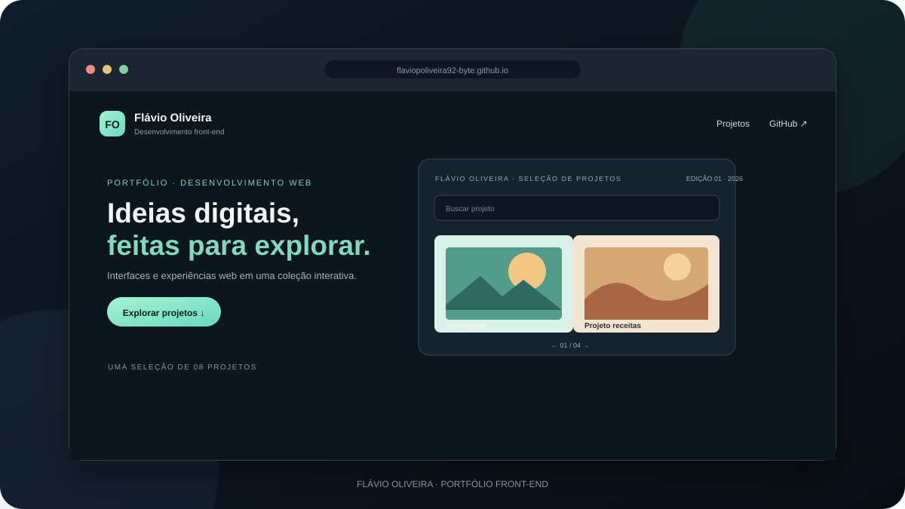

<div align="center">

# ✦ Flávio Oliveira
### Portfólio de projetos · Desenvolvimento front-end

**Ideias digitais, feitas para explorar.**

Uma coleção de interfaces e experiências web que venho criando enquanto aprendo e pratico desenvolvimento front-end.

[🌐 Explorar meu portfólio](https://flaviopoliveira92-byte.github.io/rockeseat-projetos/?v=e15a70d)

</div>

---

## ✨ Projetos em destaque

| Projeto | O que você vai encontrar |
| --- | --- |
| [Zingen — app de música](./LANDING%20PAGE%20DE%20APP/) | Uma landing page para um aplicativo de música e karaokê. |
| [Portal de notícias](./PORTAL%20DE%20NOTICIAS/) | Uma página editorial sobre tecnologia e inovação. |
| [Projeto receitas](./PROJETO%20RECEITAS/) | Receita apresentada com ingredientes e modo de preparo. |
| [Travelgram](./PROJETO%20VIAGENS/) | Um perfil de viagens cheio de histórias e paisagens. |
| [Matrículas Estrelas do Amanhã](./Formulario%20de%20matriculas/) | Formulário de matrícula para uma escola infantil. |
| [Snitap — patins em movimento](./LP%20de%20patins%20animada/) | Landing page com animações e galeria de patins. |
| [Local Turístico — Conheça Busan](./Local%20Tur%C3%ADstico/) | Um guia visual de atrações históricas e culturais de Busan. |
| [Convite — Festivite](./Convite/) | Uma experiência para criar convites digitais personalizados. |

## 🧭 Um portfólio para explorar

O catálogo reúne os projetos em uma experiência interativa: dá para folhear as páginas, buscar trabalhos, filtrar por categoria e compartilhar a seleção. Também é possível salvar o catálogo em PDF.

## 🛠️ Tecnologias

`HTML5` · `CSS3` · `JavaScript`

Os projetos são páginas estáticas e não precisam de etapa de build. O catálogo usa a biblioteca PageFlip, carregada por CDN.

## 🚀 Abrir localmente

1. Clone este repositório:

   ```bash
   https://github.com/flaviopoliveira92-byte/rockeseat-projetos.git
   ```

2. Abra a pasta do projeto.
3. Abra `index.html` no navegador. Para ver um projeto específico, abra o `index.html` dentro da pasta dele.

## 👋 Sobre mim

**Flávio Oliveira** · Desenvolvedor front-end em evolução contínua.

[GitHub](https://github.com/flaviopoliveira92-byte) · [Ver portfólio](https://flaviopoliveira92-byte.github.io/rockeseat-projetos/?v=e15a70d)

## 👀 Prévia do portfólio

[](https://flaviopoliveira92-byte.github.io/rockeseat-projetos/?v=e15a70d)

*Clique na imagem para explorar o catálogo interativo.*

## 🌱 Meu primeiro repositório

Este portfólio marca o início da minha jornada no desenvolvimento front-end. Aqui reúno projetos feitos para aprender, praticar e transformar ideias em experiências web.
